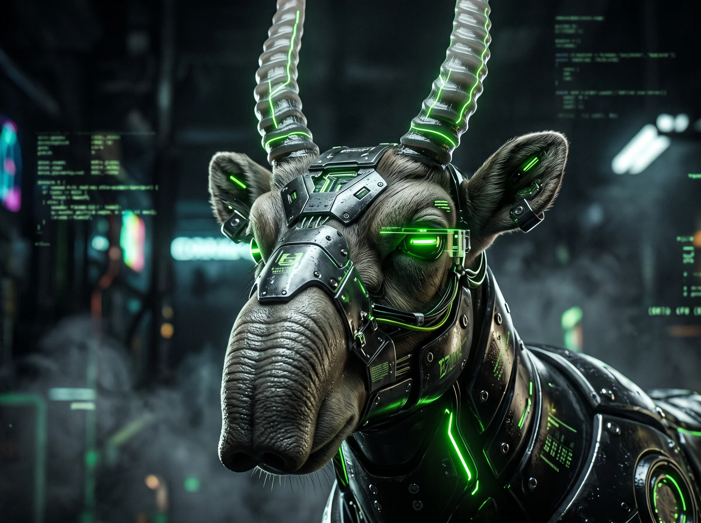

## 小渕 正明 / Masaki Kobuchi

### Hi there 👋

福岡を拠点に、Web開発・インフラ構築・AI技術を活用したプロダクト制作を行っています。  
個人の成長とチームのコラボレーションを大切にし、誰もがテクノロジーの恩恵を享受できる開発を目指しています。

---

### 💡 開発・制作に対するスタンス

- **障害や環境を越えるアクセシビリティ**：AIをはじめとするテクノロジーを味方に付け、一歩先を目指す挑戦をサポート・体現します。
- **再現性と品質（ISO 9001的視点）**：堅牢でメンテナンス性の高いコードと、安全で再現性のある運用プロセスを追求します。
- **課題解決と対等な協働（アドラー心理学的視点）**：チームメンバーや学習者への敬意を忘れず、互いの目的（目的論）に沿った前向きなコミュニケーションを心がけています。

---

### 🛠 Tech & Tools

#### Frameworks & Languages

#### Infrastructure & Networks

#### AI / Generative Environments

- **Backend / Web**: Laravel, Django, Node.js
- **Frontend / SSG**: Astro（高速な静的サイト・ブログ構築）
- **Infrastructure & Network**: 
  - Linuxサーバー構築・運用
  - Cloudflare（DNS設定・Cloudflare Tunnelを活用した固定IPなしでの安全なWebサイト外部公開）
- **AI / Local Environment**: 
  - **Local LLM**: Ollamaを活用したローカルLLM環境構築・システム連携
  - **Image Generation**: ComfyUI / AUTOMATIC1111を活用したプロトタイピングおよびパイプライン構築
- **Automation & Others**: Google Apps Script（業務/生活自動化）, Unity, JavaScript

📸 Generative AI Gallery

  
  

---

### 📝 Media & Articles

- 📖 **[note](https://note.com/gentle_dietes302)** — AI技術、心理学、思考の整理や小説など
- 📰 **[Ayatori News](https://news.ayatori-inc.co.jp/)** — 最新のAIニュース・動向の発信